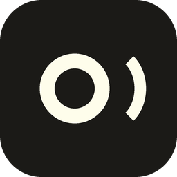

  

<h1 align="center">Oralis</h1>

  <b>Sélectionne un texte, appuie sur un raccourci : Oralis te le lit à voix haute.</b> 
  Pour Windows 10 et 11. Gratuit.

  <a href="https://github.com/revealed-valentin/oralis/releases/latest/download/Installer-Oralis.exe"><b>⬇ Télécharger Oralis</b></a>

---

## Ce que fait Oralis

- **Lit n'importe quel texte** : sélectionne-le dans ton navigateur, un PDF, un mail…, puis fais **Ctrl + Alt**.
  Refais le raccourci pour arrêter.
- **Lit les images et les captures d'écran** : copie une image, fais le raccourci, Oralis reconnaît le texte et le lit.
- **Lit tes fichiers** : PDF (même scannés), Word, texte, images. Il reprend là où tu t'étais arrêté.
- **Mode dictée** : il te dicte un texte par groupes de mots, avec le temps qu'il faut pour écrire.
- **Crée des MP3** de n'importe quel texte.
- **Voix gratuites** en français et en anglais, et il change de langue tout seul.
- **Voix naturelles illimitées** : si ton PC a une carte graphique NVIDIA (6 Go ou plus), Oralis peut installer
  une voix très humaine qui tourne sur ton ordinateur, sans crédits ni internet.
  Tu peux aussi brancher ton compte ElevenLabs.
- Une fenêtre claire et sombre, et il se met à jour tout seul.

## Installer

1. Clique sur **[Télécharger Oralis](https://github.com/revealed-valentin/oralis/releases/latest/download/Installer-Oralis.exe)**.
2. Ouvre `Installer-Oralis.exe`.
3. Si Windows affiche « Windows a protégé votre ordinateur », clique sur **Informations complémentaires**,
   puis **Exécuter quand même**. (L'appli est récente et pas encore signée, c'est normal.)
4. C'est tout : Oralis s'ouvre, et un raccourci apparaît sur ton Bureau et dans le menu Démarrer.

Pour le désinstaller : **Paramètres > Applications > Oralis > Désinstaller**.

## Créé par

[@revealed-valentin](https://github.com/revealed-valentin) et [@blyaat85-lang](https://github.com/blyaat85-lang).

---

© 2026 revealed-valentin et blyaat85-lang. Tous droits réservés. Oralis est gratuit pour un usage personnel ;
le code n'est pas public. Voir <a href="LICENCE.md">LICENCE</a>.
